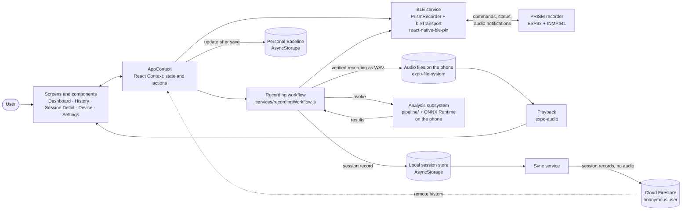

# PRISM — Smart Inhaler Mobile App

PRISM (Pulmonary Response and Inhaler System Monitor) is a smart-inhaler research platform for
pressurised metered-dose inhalers. This repository contains its **Android mobile application**, built
with **React Native and Expo**.

The app works with the **PRISM recorder**, an ESP32 board with an INMP441 MEMS microphone. It:

- connects to the recorder over **Bluetooth Low Energy (BLE)**;
- starts a recording and receives the audio in packets;
- verifies that the recording arrived complete and unaltered;
- stores the recording on the phone and plays it back;
- runs the PRISM analysis subsystem **entirely on the phone**, with ONNX Runtime and no server;
- keeps every session in an **offline-first history** that synchronises to Cloud Firestore when a
  connection is available.

The app reports measurements, not verdicts. A session shows:

- whether inhalation events were detected;
- when each event occurred and how long it lasted;
- whether each event could be measured, and if not, why.

It does not rate inhaler technique, give quality percentages or produce clinical labels.

---

## Contents

1. [Key features](#key-features)
2. [Technology stack](#technology-stack)
3. [Application architecture](#application-architecture)
4. [Directory structure](#directory-structure)
5. [Screens and navigation](#screens-and-navigation)
6. [Application state and data flow](#application-state-and-data-flow)
7. [BLE communication with the ESP32](#ble-communication-with-the-esp32)
8. [Audio capture, storage and playback](#audio-capture-storage-and-playback)
9. [Session lifecycle](#session-lifecycle)
10. [Analysis integration](#analysis-integration)
11. [Session history](#session-history)
12. [Personal Baseline](#personal-baseline)
13. [Data persistence](#data-persistence)
14. [Error handling and reliability](#error-handling-and-reliability)
15. [Setup and installation](#setup-and-installation)
16. [Running the app](#running-the-app)
17. [Building an Android debug APK](#building-an-android-debug-apk)
18. [Testing](#testing)
19. [Current limitations](#current-limitations)

---

## Key features

- **BLE connection to the PRISM recorder:**
  - scan for and connect to PRISM devices, with the device's own information shown;
  - quiet automatic reconnection at start-up;
  - an "Identify" command that blinks the device's LED.
- **Start Event recording workflow:** one button records with the device. The Dashboard shows each
  real step (Connect → Record → Transfer → Analyse → Done). Errors come with their cause and the next
  useful action.
- **Verified audio transfer:**
  - lost BLE packets are requested again while recording, then again after recording;
  - a recording is accepted only with the exact sample count and a matching CRC-32 checksum.
- **Local audio storage and playback:** each verified recording is saved as a WAV file on the phone.
  It can be played back from the session screen.
- **On-device analysis:**
  - an ONNX event-detection model runs through ONNX Runtime on the phone;
  - every result is checked against the analysis contract before the app uses it.
- **Offline-first session history:**
  - sessions are stored on the phone first and uploaded to Firestore in the background, without
    duplicates;
  - each session shows its sync state.
- **History and trends:** a list of all sessions, a 14-day activity chart, and a detailed screen for
  each session.
- **Personal Baseline:** a demonstration of how a baseline is created and gradually updated from
  eligible sessions. It has a summary on the Dashboard and a per-session view with reset.
- **Settings:** recording length, vibration on result, local audio usage, the anonymous account ID
  and app information.

---

## Technology stack

| Area | Technology | Role in the app |
|---|---|---|
| Language | JavaScript (ES modules, JSDoc types) | All app, service and analysis code (no TypeScript) |
| UI framework | React Native 0.86 (New Architecture, Hermes), React 19.2 | Screens and components |
| Tooling | Expo SDK 57 (development build, config plugins, `expo prebuild`) | Native project generation, autolinking, Expo modules |
| Navigation | React Navigation 7 (bottom tabs + stack) | Four tabs; History has a list → detail stack |
| State | React Context + hooks (`context/AppContext.js`) | App-wide state and actions shared by all screens |
| Bluetooth LE | `react-native-ble-plx` 3.5.1 | Scan, connect, GATT reads, writes and notifications |
| Audio playback | `expo-audio` | Plays recordings stored on the phone (microphone recording is disabled in its config plugin) |
| Files and assets | `expo-file-system`, `expo-asset` | WAV files in the app's document directory; loading the bundled model |
| On-device inference | `onnxruntime-react-native` 1.24 | Runs the event-detection model |
| Signal processing | `fft.js` | FFTs in the JavaScript feature extraction |
| Local persistence | `@react-native-async-storage/async-storage` 2.2 | Sessions, settings, last device, Personal Baseline, Firebase login |
| Cloud | Firebase JS SDK 12: Anonymous Auth, Cloud Firestore | Optional background sync of session records |
| Android build | Gradle 9.3 (generated by Expo prebuild), JDK 17, Android SDK 36, NDK 27.1 | Native build of the development app |
| Testing | Node.js test scripts (`npm test`), `onnxruntime-node`, Ajv | Logic, protocol, analysis-contract and UI-wording tests without a phone |
| Native fixes | `patch-package`, `react-native.config.js` | Make `onnxruntime-react-native` build and register on Android |

The app needs native modules (ONNX Runtime and BLE), so **it does not run in Expo Go**. It is built
as an Expo development build (see [Running the app](#running-the-app)).

---

## Application architecture

The app has four layers.

- **Presentation:** screens and components in `screens/` and `components/`. Pure "view" functions in
  `utils/` turn session records and workflow states into display text.
- **Application state:** a single React Context, `context/AppContext.js`. It owns the state and wires
  the services together.
- **Services:** in `services/`, for BLE, the recording workflow, audio files, session storage, sync,
  authentication and the Personal Baseline.
- **Analysis subsystem:** in `pipeline/`, with the bundled model and contract files in `assets/ml/`.

The services and the analysis code do not import React. Their dependencies are passed in: the BLE
link, storage, the analysis factory and loggers. As a result, the same code runs in the app and in the
Node.js tests.



---

## Directory structure

```
smart-inhaler-app/
├── App.js                     # Start-up: local sessions, device reconnect, background sign-in and sync
├── index.js                   # Expo entry point
├── app.json                   # Expo config: Android package, config plugins (BLE, audio, ONNX Runtime)
├── metro.config.js            # Bundles .onnx files as assets; enables package exports for Firebase
├── react-native.config.js     # Autolinking override that registers ONNX Runtime's Android package
├── patches/                   # patch-package fix for onnxruntime-react-native under Gradle 9
├── context/AppContext.js      # App-wide state and actions (React Context)
├── navigation/AppNavigator.js # Bottom tabs and the History stack
├── screens/                   # Dashboard, History, SessionDetail, Device, Settings
├── components/                # RecordingPanel, SessionCard, Waveform, RecordingPlayback, CaptureCard, ...
├── services/
│   ├── ble/                   # Protocol codec, AudioReassembler, PrismRecorder, bleTransport, test simulator
│   ├── bleService.js          # App-level BLE access point (one recorder per app process)
│   ├── recordingWorkflow.js   # Recording lifecycle state machine
│   ├── hardwareSession.js     # Builds a session record from analysis results and capture metadata
│   ├── inferenceService.js    # The shared, lazily created analysis pipeline
│   ├── audioFiles.js          # WAV files on the phone: save, read, delete, playback URI
│   ├── localSessionStore.js   # Sessions on the phone (AsyncStorage)
│   ├── syncService.js         # Background Firestore upload and history merge
│   ├── sessionService.js      # Firestore reads and writes for sessions
│   ├── sessionRecord.js       # Session record format and Firestore-safety check
│   ├── demoBaseline.js        # Personal Baseline store
│   └── authService.js, deviceService.js, storageService.js
├── pipeline/                  # Analysis subsystem: DSP, ONNX detector, contract validation, assessment
│   └── runtime/               # reactNative.js (the app) and node.js (the tests)
├── utils/                     # Pure view helpers (sessionView, recordingView, researchView, ...), theme
├── assets/ml/                 # ONNX model, analysis contracts, frozen baselines, schemas, golden test data
├── firebase/                  # Firebase initialisation; example_config.js template (config.js is git-ignored)
├── firmware/                  # ESP32 recorder firmware, BLE protocol specification, PC test client
└── tools/                     # On-device conformance runner; pipeline comparison scripts
```

`android/` is generated by `expo prebuild` and is git-ignored.

---

## Screens and navigation

`navigation/AppNavigator.js` defines a **bottom-tab navigator** with four tabs. The History tab holds
a **stack navigator** (list → detail).

| Screen | Purpose |
|---|---|
| **Dashboard** | The main screen. See the list below. |
| **History** (`HistoryList`) | A 14-day trend chart (device recordings and detected inhalations per day), the total number of sessions, and a card per session showing status, source, sync state, time and counts. |
| **Session Detail** | Everything stored for one session (see [Session history](#session-history)). It is opened from History, from the Dashboard's last session, or from "View result" after a recording. |
| **Device** | Scan for PRISM recorders (sorted by signal strength), connect to a chosen one or to the nearest, disconnect, and identify the device by blinking its LED. Shows the information the device reports: firmware, microphone, sample rate, recording length limits, protocol version and message size. |
| **Settings** | Recording length (5, 10 or 15 s), vibration on result, the number and size of recordings kept on the phone, the anonymous user ID and app information. |

The Dashboard shows:

- the device connection banner, which opens the Device tab;
- the **On-board recording** panel with the **Start Event** button;
- the Cloud Sync card with a "Sync now" button;
- the last session, which opens it;
- the Personal Baseline summary.

Reusable components keep the screens small:

- `RecordingPanel` shows the recording lifecycle.
- `SessionCard`, `ResultBadge` and `StatusTag` show a session's status, source and sync state.
- `Waveform` draws a peak envelope with the detected events marked.
- `RecordingPlayback` and `CaptureCard` show the device recording and its transfer checks.
- `ResearchMeasurements`, `DemoBaselineCard` and `TrendsCard` cover research data, the baseline and
  trends.

Text shown to the user comes from the pure helpers in `utils/` (`sessionView.js`, `recordingView.js`,
`captureView.js`, `researchView.js`, `trendsView.js`). They are unit-tested without rendering React
Native.

---

## Application state and data flow

State is managed with **React Context and hooks**; there is no Redux or other state library.
`AppProvider` (`context/AppContext.js`) wraps the navigator. Screens read state and call actions
through `useAppContext()`.

| Kind of state | Where it lives | Survives a restart? |
|---|---|---|
| UI-only state: scan results, busy flags, expanded sections, loaded waveform | `useState` inside a screen or component | No |
| App-wide in-memory state: session list, device connection and info, recording lifecycle, sync status, settings, Personal Baseline | `AppContext` | Reloaded from storage at start-up |
| Locally persisted state | AsyncStorage and the file system (see [Data persistence](#data-persistence)) | Yes |
| Remote state | Cloud Firestore, under the anonymous user | Yes, when Firebase is configured |

Typical flows:

- **Start-up (`App.js`):**
  1. The sessions stored on the phone are loaded and the navigator is shown. No network is needed.
  2. In the background, the app reconnects to the last device. This happens only if the Bluetooth
     permissions were granted earlier, so it never prompts.
  3. A sync pass is requested.
  4. The app signs in anonymously and merges the Firestore history into the list.
- **Device state:** the BLE recorder publishes connect and disconnect events, including a device going
  out of range. `AppContext` subscribes to them. It updates the connection state, remembers the device
  for the next start-up, and registers it in Firestore in the background.
- **Recording:** the Dashboard calls `startEvent()`. `AppContext` runs the recording workflow. Every
  workflow state is published to `recordingState`, which `RecordingPanel` renders.
- **Saving a session:** the workflow's `save` callback writes the record to the local store and
  refreshes the list. The Firestore upload is left to the sync service, and the Personal Baseline is
  updated. The UI never waits for the network.
- **Opening a session:** the session object is passed as a navigation parameter. Session Detail looks
  it up again in the context's list so that its sync state stays current while the screen is open.

---

## BLE communication with the ESP32

The PRISM recorder firmware (`firmware/prism_ble_recorder/`) exposes one custom GATT service. The
protocol, "prism-ble-audio" v1, is specified in [`firmware/PROTOCOL.md`](firmware/PROTOCOL.md).

| Characteristic | Used for |
|---|---|
| CONTROL (write) | Commands: start a recording of *n* samples, abort, resend a sample range, release a recording, identify, request status |
| STATUS (read + notify) | JSON state of the recorder: idle / recording / ready / error, progress, sample count, CRC-32 |
| AUDIO (notify) | Audio packets: a header (recording tag, sequence number, sample offset) followed by 16-bit samples |
| INFO (read) | JSON device information: protocol version, sample rate, firmware, microphone, sample limits |
| META (read) | JSON capture diagnostics of the last recording |

### Layers

The BLE code is split so that hardware communication never reaches the UI directly:

| Module | Responsibility |
|---|---|
| `services/ble/protocol.js` | Pure codec: command encoding, status and info parsing, audio packet parsing, CRC-32 |
| `services/ble/AudioReassembler.js` | Rebuilds one recording from its packets and verifies it |
| `services/ble/PrismRecorder.js` | Protocol logic: connect handshake, record, resend, verify, abort, identify, state events. Uses an injected transport. |
| `services/ble/bleTransport.js` | The only module that imports `react-native-ble-plx`: permissions, adapter state, scan, connect, read, write, notifications, disconnect events |
| `services/bleService.js` | One recorder per app process; the functions screens and `AppContext` call |
| `services/ble/testing/fakePrismDevice.js` | A protocol simulator. It is used only by the Node tests and is not part of the app. |

### Lifecycle

1. **Permissions and adapter.**
   - Permissions are requested only when the user connects: `BLUETOOTH_SCAN` and `BLUETOOTH_CONNECT`
     on Android 12+, fine location on Android 11 and older. Scanning is declared `neverForLocation`.
   - If Bluetooth is off or unauthorised, the user is told. The app does not switch it on.
2. **Discovery.** The scan is filtered by the PRISM service UUID. Results are sorted by signal
   strength. "Connect to the nearest device" stops at the first result.
3. **Connection and handshake.**
   - The app connects (10 s timeout) and requests a 247-byte ATT MTU and high connection priority.
   - It reads INFO and refuses the device if:
     - its protocol version differs from the app's;
     - it does not record at 8000 Hz;
     - the negotiated MTU is below 64 bytes.
   - It then subscribes to STATUS notifications and to disconnect events.
4. **Recording command.** START carries the number of samples, which is the recording length from
   Settings × 8000. The device answers with a RECORDING status that carries a recording tag and the
   number of samples per packet.
5. **Receiving audio.**
   - Audio packets stream in while the device records. `AudioReassembler` places each packet by its
     sequence number.
   - A gap in the sequence is requested again immediately with SEND, while the device still holds
     those samples in its ring buffer.
   - Recording progress comes from the device's own STATUS notifications; nothing advances on a timer.
6. **Completion and repair.**
   - The READY status carries the final sample count and the device's CRC-32.
   - The app waits briefly for packets still in flight. It then runs up to three resend rounds for
     any packets still missing.
7. **Validation.** The recording is accepted only if all of these hold:
   - the sample rate is 8000 Hz;
   - the sample count is exactly the one requested;
   - every packet is present with its expected length;
   - the CRC-32 computed on the phone equals the device's.

   The app then reads the META capture diagnostics and sends RELEASE so that the device can free the
   recording.
8. **Hand-off.** `record()` returns the verified 16-bit PCM together with a transfer report:
   - packet counts;
   - missing, duplicate or invalid packets;
   - resend requests;
   - both CRCs;
   - the duration.

   **No partial recording is ever returned:** any failure throws a `RecorderError` with a code.

### Failures

| Failure | How it is handled |
|---|---|
| Timeouts | Start (5 s), the recording itself (its length + 20 s) and each resend round (10 s) are bounded |
| Disconnect during a recording | Every pending wait fails with `DISCONNECTED` |
| Any other failure while the device is still recording | The app sends ABORT (best effort) |
| Errors in general | Each has a code (`BLUETOOTH_UNAVAILABLE`, `PERMISSION_DENIED`, `DEVICE_NOT_FOUND`, `CRC_MISMATCH`, `TRANSFER_INCOMPLETE`, …). The UI maps it to a sentence and a next action. |

---

## Audio capture, storage and playback

- **Capture:**
  - The audio is captured by the **PRISM device**: INMP441 microphone, 8 kHz, 16-bit, mono.
  - The phone's own microphone is not used; `expo-audio` is configured with microphone recording
    disabled.
  - The phone receives the samples over BLE as described above.
- **Storage:**
  - After verification, `services/audioFiles.js` writes the recording as a 16-bit mono 8 kHz WAV
    file in the app's document directory (`<documents>/recordings/`), using `expo-file-system`.
  - The session record stores only the file name (`capture.audio.file`), never the audio itself.
- **Playback:**
  - `components/RecordingPlayback.js` plays that WAV file with `expo-audio` (`useAudioPlayer`) on the
    Session Detail screen.
  - It plays only the device recording of that session. If the file is not on this phone (recorded on
    another phone, or removed), it says so instead of playing something else.
- **Privacy:**
  - Raw audio stays on the phone; nothing uploads it, and the cloud receives only session records.
  - Settings shows how many recordings are stored locally and how much space they use.

---

## Session lifecycle

A session starts when the user presses **Start Event** on the Dashboard.
`services/recordingWorkflow.js` drives a single state machine:

```
IDLE → CONNECTING → READY → RECORDING → TRANSFERRING → SAVING → ANALYSING → COMPLETED
                         ↘ ERROR (from any step; the failed step and the reason are kept)
```

1. **Connect.** If no device is connected, the workflow connects to the nearest PRISM recorder.
   Otherwise it uses the connected one.
2. **Record.** The device records for the configured length. The panel shows the seconds captured and
   received.
3. **Transfer.** The remaining packets arrive, missing ones are requested again, and the recording is
   verified.
4. **Save.** The verified recording is written to the phone as a WAV file. This step is mandatory: if
   it fails, nothing is analysed and the attempt ends in an error.
5. **Analyse.** The workflow invokes the analysis subsystem (see
   [Analysis integration](#analysis-integration)) and builds the session record. In the current build
   the result is not computed from the audio captured in this session; see
   [Current limitations](#current-limitations).
6. **Store.** The session record is stored on the phone and appears in the history immediately. If the
   record cannot be stored, the saved WAV is deleted, so no audio file is left without a session.
7. **Complete.**
   - The phone can vibrate, depending on Settings.
   - The panel offers **View result**, which opens Session Detail, and **Record again**.
   - The Firestore upload and the Personal Baseline update happen afterwards, in the background.

While a recording runs, a second start is ignored, and the Device screen disables Identify and
Disconnect. After an error, the panel shows **Connect device** if the link was the problem and
**Try again** otherwise.

---

## Analysis integration

The analysis is a separate subsystem in `pipeline/`, with a defined input and output contract. The
mobile app treats it as a black box: it supplies audio in the agreed format and consumes a validated
result. Recording, persistence and presentation do not depend on how the model works internally.

### Invocation

- `services/inferenceService.js` exposes `getPipeline()`.
  - It creates one pipeline per app process, lazily, on first use.
  - If creation fails, the next call tries again.
- The runtime binding, `pipeline/runtime/reactNative.js`:
  1. resolves the bundled model file (`assets/ml/inhaler_cnn.onnx`) with `expo-asset`;
  2. reads its bytes with `expo-file-system`;
  3. checks its SHA-256 against the contract;
  4. creates an `onnxruntime-react-native` inference session from the bytes.
- **Inference runs locally**: feature extraction runs in JavaScript, and the model runs in ONNX
  Runtime's native library. There is no server call.
- `services/hardwareSession.js` is called by the recording workflow. It runs the pipeline and
  assembles the session record.

### Input

`pipeline.run(source)` accepts any object with an `acquire()` method. `acquire()` must return mono
PCM samples at **8000 Hz** with a recording ID and a recording time. `pipeline/sources/` contains
adapters for 16-bit BLE sample buffers, WAV bytes and synthetic test audio.

The pipeline checks the input itself. A wrong sample rate, multiple channels, empty or non-finite
audio, or audio shorter than one detector window produces an `INPUT_ERROR` result instead of an
exception.

### Output

`run()` returns one result object per recording. It is validated against the contract
(`assets/ml/v2_validation/inference_output.schema.json`) before it is returned. The app uses:

- **`recording_status`**: `EVENTS_DETECTED`, `NO_INHALATION_DETECTED` or `INPUT_ERROR`;
- **`events`**: start time, end time and duration of each detected inhalation event, its status
  (scoreable or not), and the reasons when it is not scoreable;
- **internal measurements**: per-event scores and normalised feature values. These are kept in the
  record but are not shown in the main views.

A second, separate step adds a research assessment of each measurable event: how far its acoustic
features are from bundled population statistics. A status object explains why per-user
personalisation is unavailable. Both live in `pipeline/` and are stored next to the analysis output,
not merged into it.

`SessionAggregator` and `buildSessionRecord` combine everything into one session record:

- a session status: `SCORE_ONLY`, `NOT_SCOREABLE`, `NO_INHALATION_DETECTED`, `INPUT_ERROR` or
  `PROCESSING_ERROR`;
- the counts;
- the unchanged analysis output;
- the assessment;
- the capture metadata.

The record is checked to be plain JSON that Firestore can store unchanged.

### Errors and missing results

| Situation | Result |
|---|---|
| The pipeline cannot run (model, runtime or file failure) | The session is stored with status `PROCESSING_ERROR` and the error message. The recording is not silently lost. |
| The input is invalid | `INPUT_ERROR`, with a readable reason |
| The research assessment fails | Its error is recorded. The main analysis result stands on its own. |
| No inhalation is found | `NO_INHALATION_DETECTED`. This is a valid recording state, not an error. |

### Presentation

The main views show only:

- the status;
- event times and durations;
- the not-scoreable reasons, phrased as measurement conditions (for example "Segment shorter than
  0.5 s, the minimum length for measurement").

The numeric measurements appear only in a collapsed **Research measurements** section of Session
Detail, after an explanation that they are not a medical result.

The UI tests scan every screen and component reachable from `App.js`. They check that no
quality, technique, NORMAL/ANOMALY or clinical wording is displayed.

---

## Session history

The History tab lists every session, newest first. The list merges two sources without duplicates:

- the sessions stored on this phone;
- the Firestore history of the anonymous user.

Each card shows the status, the source (for example "PRISM device (BLE)"), the sync state, the time and
counts. Sessions stored by earlier app versions in older formats are kept, labelled "Legacy record",
and not interpreted.

A session record ties together:

| Part | Content |
|---|---|
| Identity and metadata | Session ID, record format version, source, device ID, app version, time saved and time recorded |
| Analysis results | Session status, counts, events and the unchanged analysis output |
| Capture block | Device name, firmware and microphone; sample rate and length; transfer integrity (packets, resends, both CRC-32 values, verified flag); firmware capture checks; name of the local WAV file |
| Research block | The research assessment and the personalisation status |
| Sync state | Pending or synced, attempts, last error. This is stored beside the record on the phone, not inside it. |

Tapping a session opens **Session Detail**, which shows the following, top to bottom:

- notes and any input or processing errors;
- status, source, saved and recorded times, and sync state;
- the **Recording** card: a waveform of the analysed audio with the detected events marked, and the
  player for the device recording;
- **Recording and transfer**: device, firmware, length, sample rate with the measured device clock,
  and each verification check;
- summary counts;
- the list of detected events with their times, durations and reasons;
- the collapsed Research measurements;
- the Personal Baseline card;
- the device identifier.

---

## Personal Baseline

The Personal Baseline demonstrates how a baseline is initialised and then gradually adapted as new
sessions arrive. It is implemented in `services/demoBaseline.js` and has its own storage, separate
from the session records.

**It is not a personalised or clinically validated assessment.** It is not built from the user's own
inhalations, and it is not yet personalised to an individual's inhalation patterns. The app shows a
statement to this effect wherever the baseline appears.

- **Dashboard:**
  - the state (Initialized / Not initialized) and the explanation;
  - once initialised: the number of eligible sessions processed, the most recent distance and the time
    of the last update.

  The summary is read-only.
- **Which sessions count:** only newly stored Start Event sessions that pass the eligibility checks.
  Among other checks, a session must have:
  - a verified device recording;
  - an analysis that completed with status `SCORE_ONLY`;
  - a research assessment with exactly one measurable event and four valid measurements.

  Other sessions are skipped, and their Session Detail screen says why.
- **How it changes:**
  - The first eligible session initialises the baseline.
  - Each later eligible session is first compared with the current baseline, which gives a distance in
    the normalised measurement space (no threshold, no categories).
  - The baseline then moves part of the way towards the new session, as an exponential moving average.
- **One contribution per session:** the baseline is updated only when a session is stored, never by
  opening a screen. The session ID is recorded, so a session can contribute only once.
- **Session Detail:** the Personal Baseline card shows:
  - the baseline's state and counts;
  - what this session did: initialised it, updated it (with the distance before the update), was
    skipped (with the reason), or was recorded before the last reset.
- **Reset:** "Reset personal baseline" on the Session Detail card asks for confirmation. It then clears
  only the baseline and its processing record; sessions, recordings and settings are kept.
- **Persistence:** stored in AsyncStorage on the phone and validated when it is loaded. An unreadable
  baseline is reported and never used; the user can reset it. It is not uploaded to Firestore.

---

## Data persistence

| Data | Mechanism | Location |
|---|---|---|
| Session records + sync state | AsyncStorage, one key per session (`@PRISM:session:<session_id>`) | Phone |
| Device recordings (WAV) | `expo-file-system` | Phone only: `<documents>/recordings/` |
| Settings (recording length, vibration) | AsyncStorage (`@PRISM:settings`) | Phone |
| Last connected device (for reconnection) | AsyncStorage | Phone |
| Personal Baseline | AsyncStorage | Phone only |
| Anonymous Firebase login | Firebase Auth with AsyncStorage persistence | Phone |
| Session records | Cloud Firestore `users/{uid}/sessions/{session_id}` | Cloud, when configured |
| Registered devices (name, last connected) | Cloud Firestore `users/{uid}/devices/{deviceId}` | Cloud, when configured |

### Local storage (offline-first)

- **Local first.** A session counts as safe as soon as it is on the phone. `syncService.saveSession`
  writes it locally and then only *requests* an upload.
- **The record is not changed by sync.** The stored record is never modified afterwards. Sync
  bookkeeping is kept beside it. Unreadable entries are reported and skipped, never overwritten.

### Cloud sync (Firestore)

- **When it runs.** A sync pass runs after a save, at start-up, when the app returns to the
  foreground, and on "Sync now". Only one pass runs at a time.
- **No duplicates.** The Firestore document ID is the session ID, so a retry overwrites the same
  document instead of creating a duplicate.
- **When a session counts as synced.** A session is marked synced only when Firestore confirms the
  write. Otherwise it stays pending for the next pass. After a rejected write, the app checks the
  server for a copy that an earlier attempt may already have committed.
- **Firebase is optional at run time.** With placeholder credentials, or if Firebase rejects the
  configuration, cloud calls fail cleanly: sessions stay pending and the app works locally. Settings
  then shows "Not signed in".

---

## Error handling and reliability

- **Bluetooth.** Every failure has a code, a readable explanation and the next useful action, covering:
  - Bluetooth off or unavailable;
  - permission denied;
  - no device found;
  - protocol or sample-rate mismatch;
  - timeouts and disconnects;
  - incomplete transfers and checksum mismatches.
- **Recording validation.** Exact sample count, every packet and a CRC-32 match are required before
  anything is saved or analysed. A failed attempt saves nothing.
- **Analysis.** A model or runtime failure becomes a stored `PROCESSING_ERROR` session; invalid input
  becomes `INPUT_ERROR`. The analysis output is validated against the contract schema before use.
- **Persistence.**
  - Local writes are serialised.
  - A session that cannot be stored removes its WAV file.
  - Cloud uploads are retried, without duplicates.
  - The remote history fetch is bounded by a 20 s timeout.
- **Duplicate protection.**
  - The recording workflow ignores a second start while running, and the recorder refuses concurrent
    recordings (`BUSY`).
  - A session contributes to the Personal Baseline at most once.
- **Loading and error states.**
  - Splash screen during start-up and a loading state in History.
  - Error banners on Session Detail and an error card on the Device screen.
  - Local-store errors are shown on the Dashboard.
- **Restart recovery.**
  - Sessions, settings, the baseline and the last device survive restarts.
  - Pending uploads are retried at the next start.
  - The last device reconnects automatically when permissions allow.
  - A recording interrupted by closing the app is not resumed and nothing partial is stored.

---

## Setup and installation

### Prerequisites

- **Node.js 22.15 or later.** The project is developed with Node.js 24; part of the session tests
  needs Node ≥ 22.15. Install dependencies with npm (`package-lock.json` is committed).
- **JDK 17**, set as `JAVA_HOME` for the Android build.
- **Android SDK** with platform 36. React Native 0.86 also uses build-tools 36.0.0 and NDK
  27.1.12297006. Android Studio's SDK Manager can install them; the Gradle build can also download
  missing components when SDK licences are accepted.
- **An Android phone with Bluetooth LE**, Android 7.0 (API 24) or later, with USB debugging enabled.
- **A PRISM recorder** (ESP32 DevKit + INMP441) flashed with `firmware/prism_ble_recorder`. See
  [`firmware/README.md`](firmware/README.md) for wiring and flashing.
- Optional: **a Firebase project** with Anonymous Authentication and Cloud Firestore enabled, for cloud
  sync.

### Install

```bash
git clone <repository-url>
cd smart-inhaler-app
npm install        # also runs patch-package (postinstall) for onnxruntime-react-native
```

### Firebase configuration

`firebase/firebaseConfig.js` imports `firebase/config.js`, so this file **must exist** for the app to
bundle. Create it from the template:

```bash
cp firebase/example_config.js firebase/config.js
```

- **Without cloud sync:** leave the placeholder values. The app runs fully offline; sessions are stored
  on the phone and stay "pending".
- **With cloud sync:** replace the placeholders with your Firebase web-app configuration. Then enable
  **Anonymous** sign-in and **Cloud Firestore** in the Firebase console.

`firebase/config.js` is git-ignored. Never commit it.

---

## Running the app

The app uses native modules, so it runs as an **Expo development build**, not in Expo Go.

```bash
npm run android      # = expo run:android
```

On the first run, `expo run:android`:

1. generates `android/` from `app.json` (Expo prebuild, including the config plugins for BLE, audio
   and ONNX Runtime);
2. builds the app with Gradle and installs it on the connected phone;
3. starts the Metro bundler.

After that, if the development build is already installed, start Metro alone with:

```bash
npx expo start
```

If the phone cannot reach Metro over the network, forward the port over USB:

```bash
adb reverse tcp:8081 tcp:8081
```

### Connecting the ESP32 and permissions

1. Power the PRISM recorder. Its LED turns on while a phone is connected.
2. In the app, open **Device** and choose **Scan for PRISM devices** or **Connect to the nearest
   device**.
3. Android asks once for the **Nearby devices** permission (Bluetooth scan and connect). On Android 11
   and older it asks for location, which BLE scanning requires there.
4. Return to the **Dashboard** and press **Start Event**. Without a connected device, Start Event
   connects to the nearest recorder first.

---

## Building an Android debug APK

```bash
npx expo prebuild --platform android   # only if android/ does not exist yet
cd android
./gradlew assembleDebug                # Windows: gradlew.bat assembleDebug
```

- **Output:** `android/app/build/outputs/apk/debug/app-debug.apk`. Install it with
  `adb install -r app/build/outputs/apk/debug/app-debug.apk`, or use `./gradlew installDebug`.
- **Metro:** by default, a debug build loads its JavaScript from Metro, so start `npx expo start`
  before opening the app.
- **CPU architectures:** by default the build covers four. To build for 64-bit ARM phones only, add
  `-PreactNativeArchitectures=arm64-v8a`.
- **Release builds:** no release signing configuration or EAS configuration is included in this
  repository.

---

## Testing

```bash
npm test
```

`npm test` runs plain Node.js test scripts; there is no Jest and no phone is needed. They use the same
modules as the app. In the app, these are wired to React Native, Firebase and BLE; in the tests, those
are replaced by in-memory stand-ins, a BLE protocol simulator and `onnxruntime-node`.

| Script | What it verifies |
|---|---|
| `pipeline/test_harness.js` | Analysis stages in isolation: WAV decoding, frames, windows, ONNX output parity, event grouping, features, scoring, aggregation |
| `pipeline/test_contract.js` | `InferencePipeline.run()` against the 9 golden contract cases. Every output is validated by the contract validator and by JSON Schema (Ajv). Also checks input errors, baseline validation and SHA-256. |
| `pipeline/test_assessment.js` | The research assessment against its golden cases and schema |
| `services/test_sessions.js` | Local session store, offline-first sync, retry and duplicate handling, history merge. Firestore calls are checked with fake Firebase modules. |
| `services/test_ble.js` | Protocol codec, CRC-32, packet reassembly, and the recorder against the protocol simulator. Covers lost-packet recovery, corruption, checksum mismatch, disconnects, hung devices, refusals and version, sample-rate or MTU mismatch. Also the end-to-end workflow down to the stored session. |
| `services/test_split_source.js` | The Start Event workflow: the order of the steps, capture before analysis, storage and analysis failures, removal of unsaved audio, the playback source |
| `services/test_demo_baseline.js` | Personal Baseline: initialisation, updates, eligibility, one contribution per session, persistence, reset scope, Dashboard and session-screen wording |
| `utils/test_session_view.js` | Session → display mapping, and a static scan of all reachable UI modules for forbidden fields and wording |
| `utils/test_recording_view.js` | Recording lifecycle states, capture checks, research measurements and trends views |

Notes:

- **Dataset-dependent golden cases.** Five golden cases read dataset recordings from `PRISM_DATA_DIR`
  (default: the sibling research repository `../PRISM smart inhaler/data`). They are reported as
  skipped when that folder is absent; set `PRISM_REQUIRE_DATASET=1` to make that a failure.
- **Other stage tests.** The other `pipeline/test_*.js` files are stage tests that are run
  individually. `pipeline/test_dsp_parity.js` needs a fixture (`pipeline/parity_data.json`) that is
  not in the repository.
- **On-device conformance.** `tools/device_conformance/` runs the app's own analysis on a connected
  phone (debug build) and compares the results with the golden outputs and the Node.js run. See its
  [README](tools/device_conformance/README.md).
- **Not covered.** React Native components are not rendered in the automated tests. BLE behaviour with
  real radio conditions is exercised only on hardware.

---

## Current limitations

- **Android only.** BLE permissions, the build and on-device testing target Android. `app.json`
  contains default iOS and web entries, but those platforms are not built or tested.
- **Analysis of the device's audio.** The detector and its baseline were developed on recordings
  made with a different microphone. Tests with this hardware did not detect inhalations in its
  recordings, so analysis of PRISM-hardware audio is not validated. In the current build, the
  analysis result of a Start Event session is not computed from the audio captured by the PRISM device
  in that session. The captured recording is verified, stored and available for playback.
- **Personal Baseline.** It is a demonstration of the baseline mechanism. It is not derived from the
  user's own inhalations and is not clinically validated.
- **Per-user personalisation is unavailable.** The research method behind it is not validated, and its
  data requirements do not fit normal inhaler use. The app shows this status with its reasons.
- **Research-stage measurements.** The analysis contract is a draft. Its measurements describe acoustic
  similarity, not inhaler technique or health, and the app shows no thresholds or clinical labels.
- **Hardware features.** The recorder does not measure its battery level, so none is shown.
  Background BLE operation is disabled, and there are no reminders.
- **Accounts.** Accounts are anonymous Firebase users. Reinstalling the app creates a new user, and
  there is no account linking.
- **Audio stays on one phone.** Recordings are kept only on the phone that made them. A session
  synced to another phone has no playback there.

---

*PRISM — Capstone Project 2026*
